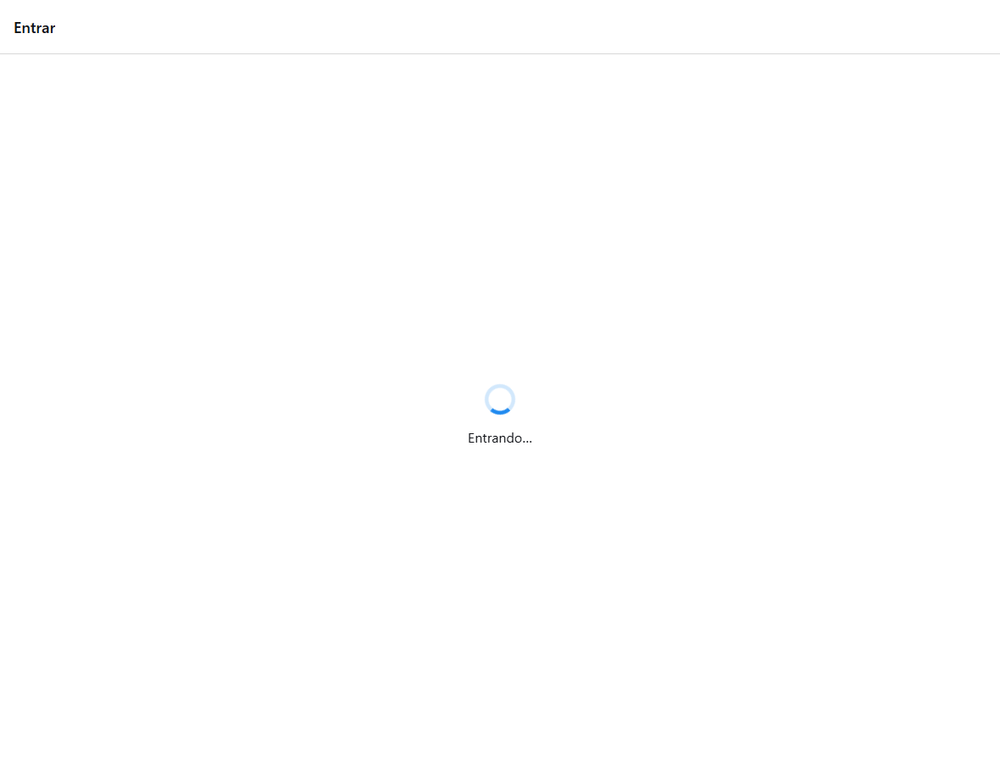
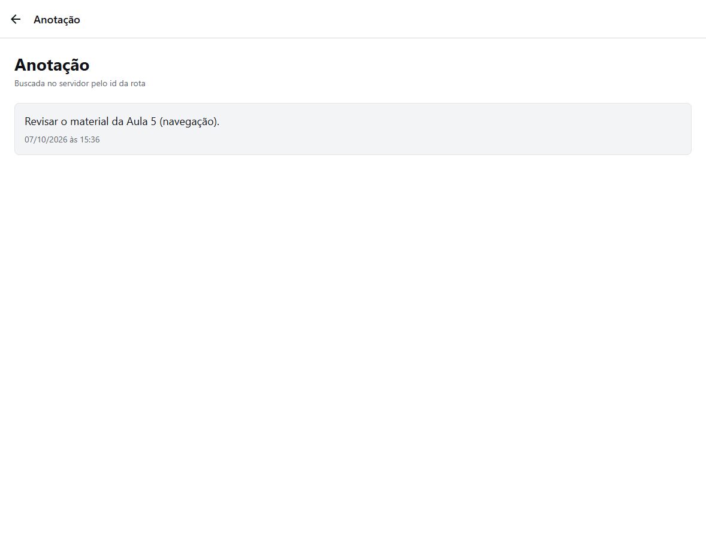
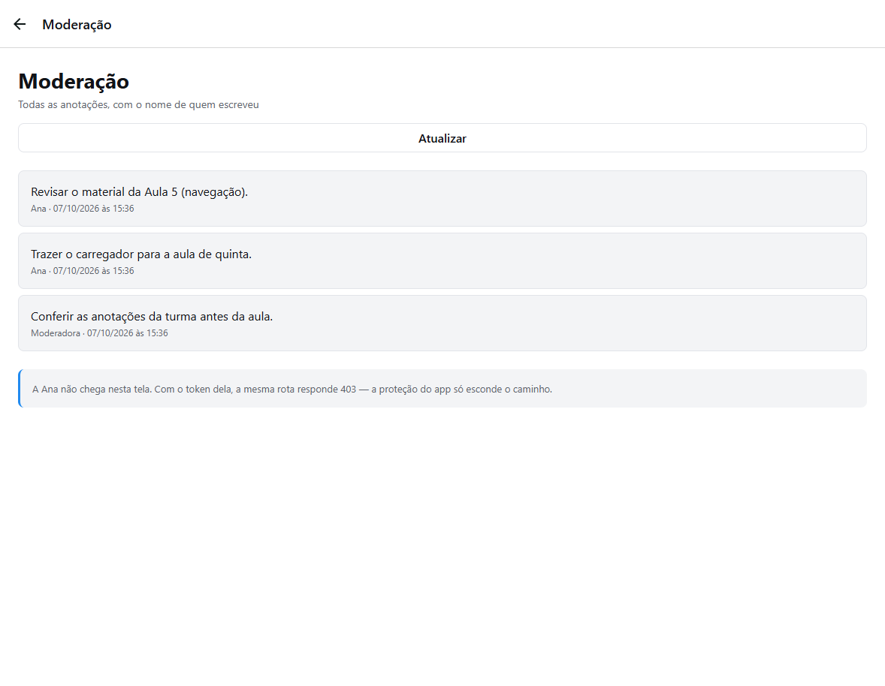
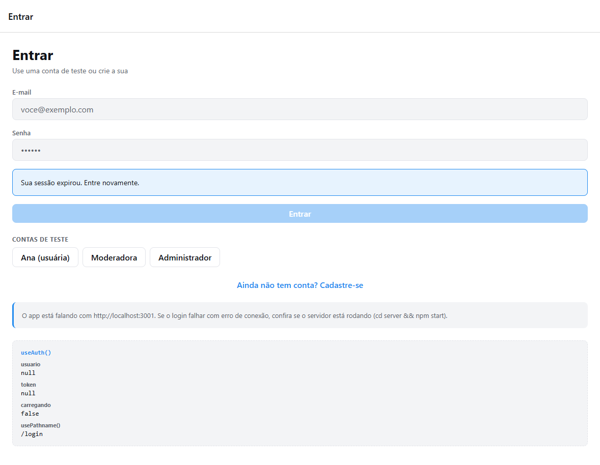

# Trabalho II — Autenticação, contexto e rotas protegidas

**Nome do aluno:** André Bastilhos Souza

**Vídeo:** [https://youtube.com/watch?v=]

Aplicativo Expo (React Native + TypeScript) com servidor Express em memória. O estado de autenticação fica na Context API (`AuthProvider` / `useAuth`). Depois de login, logout, sessão expirada ou restauração, a tela muda porque o `Stack.Protected` lê `usuario` — nenhuma tela chama `router.replace()` nem `router.push()` para ir ao login ou ao início.

## Como executar

Dois terminais, a partir desta pasta.

```bash
# terminal 1 — servidor
cd server
npm install
npm start
```

```bash
# terminal 2 — app
npm install
npx expo start
```

`w` abre no navegador, `a` no Android, `i` no iOS. O app descobre o IP do computador em que o Expo está rodando e chama a porta 3000. A tela de login mostra a URL em uso. Para apontar para outro endereço:

```bash
EXPO_PUBLIC_API_URL=http://192.168.0.10:3000 npx expo start
```

O servidor imprime as contas ao subir e também as lista em `GET /`.

| E-mail | Senha | Papel |
| --- | --- | --- |
| `ana@ifrs.edu.br` | `123456` | `usuario` |
| `moderador@ifrs.edu.br` | `mod123` | `moderador` |
| `admin@ifrs.edu.br` | `admin123` | `admin` |

Contas criadas pelo cadastro duram até o processo do servidor acabar. O "banco" é um `Map` em `server/banco.js`.

## 4.1 Sessão expirada (`401`)

Qualquer requisição que **levou token** e volta `401` chama um callback registrado pelo `AuthProvider`. O callback está em `src/services/api.ts` (`definirTratamentoDe401`, dentro de `requisicao`). As telas não repetem `if (status === 401)`.

O callback chama a limpeza da sessão: apaga o AsyncStorage, zera `usuario` e grava o aviso `Sua sessão expirou. Entre novamente.` O layout raiz vê `usuario === null` e o grupo `(auth)` volta a existir. Não há navegação manual.

`403` não entra nesse caminho. A tela que fez a chamada mostra a mensagem em `MensagemErro` e a pessoa continua logada.

Senha errada também é `401`, mas `api.login` não envia token, então não derruba a sessão nem troca o aviso. O logout voluntário marca uma flag antes de `POST /auth/logout`: se o servidor já foi reiniciado e esse logout receber `401`, o aviso de sessão expirada não aparece.

Arquivos: `src/services/api.ts`, `src/contexts/auth-context.tsx`, `src/app/(auth)/login.tsx`. Os `catch` de anotações, detalhe, moderação, administração e perfil usam `instanceof ApiError`.

## 4.2 `carregando` e o erro do login

`carregando` no contexto fica verdadeiro só durante `entrar` e `cadastrar`. Enquanto isso, a própria tela de login (ou de cadastro) renderiza `TelaDeEspera` — indicador e a mensagem "Entrando…" ou "Criando conta…".

**Por que o erro de senha errada continua na tela.** O `useState` do erro mora em `login.tsx`. Se o layout raiz trocasse o `Stack` pela tela de espera, `login.tsx` sairia da árvore e, ao voltar, o erro nasceria de novo vazio. A espera é um retorno antecipado **dentro** do mesmo componente: a instância não desmonta, então `erro`, e-mail e senha sobrevivem. Quando `carregando` volta a ser falso, o formulário reaparece com a mensagem do servidor.

A espera da restauração (requisito 4.5) é outra coisa e fica no layout raiz, antes do `Stack` existir. Ali não há formulário para preservar.

Arquivos: `src/contexts/auth-context.tsx`, `src/components/tela-de-espera.tsx`, `src/app/(auth)/login.tsx`, `src/app/(auth)/cadastro.tsx`.



## 4.3 Detalhe da anotação

`GET /anotacoes/:id` exige token. A busca em `banco.buscarAnotacaoDoUsuario` devolve a anotação só se o `usuarioId` for o do token. Id inexistente e anotação de outra pessoa caem no mesmo `404` com o texto `Anotação não encontrada.`

No app, `anotacoes.tsx` virou a pasta `src/app/(app)/anotacoes/`: `index.tsx` é a lista e `[id].tsx` é o detalhe. O item da lista é um `Link` que manda só o `id`. A tela lê o parâmetro com `useLocalSearchParams` e busca de novo no servidor. Os três estados são a espera, o `MensagemErro` (inclusive o `404`) e o `AnotacaoDetalhe`, com a data no formato `07/10/2026 às 15:36`.

**Por que a rota fica dentro de `(app)`.** Esse grupo só existe com `Stack.Protected guard={logado}` no layout raiz. A tela de detalhe herda a mesma regra da lista: sem sessão, a rota não está no navegador. Se o arquivo fosse criado fora do grupo, a URL existiria na interface mesmo com `usuario` nulo. O servidor ainda responderia `401`, mas o app mostraria uma tela autenticada para quem não entrou — a proteção da interface e a do servidor deixariam de andar juntas.

Arquivos: `server/banco.js`, `server/index.js`, `src/services/api.ts`, `src/app/(app)/anotacoes/index.tsx`, `src/app/(app)/anotacoes/[id].tsx`, `src/app/(app)/anotacoes/_layout.tsx`, `src/app/(app)/_layout.tsx`, `src/components/anotacao-item.tsx`, `src/components/anotacao-detalhe.tsx`, `src/components/formatar-data.ts`.



## 4.4 Papel `moderador`

A conta `moderador@ifrs.edu.br` / `mod123` é criada com as outras em `CONTAS_DE_TESTE`. `somentePapeis(...)` substitui o `somenteAdmin`: `GET /usuarios` aceita só `admin`; `GET /moderacao/anotacoes` aceita `moderador` e `admin` e devolve todas as anotações com o nome do autor. `usuario` recebe `403`.

No app, `/moderacao` está num `Stack.Protected` para esses dois papéis. `/admin` continua só para `admin`. O link de cada uma aparece no início só para quem pode abri-la.

Arquivos que mudaram para acrescentar o papel:

| Arquivo | Por quê |
| --- | --- |
| `server/banco.js` | Inclui a conta de teste e `listarTodasAnotacoes`, que junta o nome do autor. |
| `server/index.js` | Cria `somentePapeis`, a rota `GET /moderacao/anotacoes` e passa a listar a conta em `GET /`. `GET /usuarios` usa o mesmo middleware. |
| `src/models/usuario.ts` | `Papel` ganha `'moderador'` e surge o tipo `AnotacaoModeracao`. |
| `src/services/api.ts` | Expõe `listarAnotacoesModeracao` para a tela não chamar `fetch`. |
| `src/app/(app)/_layout.tsx` | O guard de `/moderacao` deixa a rota existir para moderador e admin. `/admin` segue exclusivo. |
| `src/app/(app)/index.tsx` | O link de moderação só é renderizado para quem tem um desses papéis. |
| `src/app/(app)/moderacao.tsx` | Tela nova: carrega a lista e mostra erro, inclusive um `403`, sem deslogar. |
| `src/components/anotacao-moderacao-item.tsx` | Cartão com texto, autor e data. |
| `src/app/(auth)/login.tsx` | Atalho da conta de teste da moderadora. |



## 4.5 Sessão que sobrevive ao reload

`entrar` e `cadastrar` gravam `{ token, usuario }` no AsyncStorage (`@aula06/sessao`). Todo `sair()` apaga a chave, inclusive o `sair` disparado pelo `401`.

`restaurando` começa verdadeiro. O layout raiz (`src/app/_layout.tsx`) mostra `TelaDeEspera` ("Restaurando sessão…") e **não monta o `Stack`** até a leitura terminar. Por isso o login não aparece por um instante.

- Sem token salvo: `restaurando` vira falso e o login aparece, sem aviso.
- `GET /auth/me` com `200`: a sessão usa o usuário devolvido pelo servidor.
- `401`: a chave é apagada e o login aparece com o aviso de sessão expirada.
- **Servidor fora do ar (status `0`).** Não é sessão inválida. O token **permanece** gravado e o login **não** entra no lugar. A mesma tela de espera mostra a mensagem de conexão e o botão "Tentar de novo", que repete o `GET /auth/me`. Outro erro que não seja `401` segue a mesma regra: sem confirmação do servidor, não há motivo para descartar o token.

Arquivos: `src/contexts/auth-context.tsx`, `src/app/_layout.tsx`, `src/components/tela-de-espera.tsx`, `src/app/(app)/perfil.tsx`. Dependência: `@react-native-async-storage/async-storage`.




## 4.6 Funções recriadas a cada render

`entrar`, `cadastrar` e `sair` são funções declaradas dentro de `AuthProvider`. Cada renderização do provider cria funções novas e, com elas, um objeto `value` novo. Quem chamou `useAuth()` re-renderiza quando esse `value` muda de referência (`Object.is`). Se o provider renderizar de novo sem a sessão ter mudado — porque o pai renderizou, por exemplo — todo leitor do contexto renderiza junto: layout, listas, botões. Numa árvore grande isso repete trabalho à toa e pode disparar efeitos que dependem de `entrar` ou `sair`.

**Neste projeto isso não chega a ser um problema prático.** `app.json` tem `experiments.reactCompiler: true`. O React Compiler memoiza o valor do contexto e as funções, no mesmo papel de um `useMemo` / `useCallback`. Com o compiler ligado, o Metro registra `React Compiler enabled`. Uma renderização do provider que não muda sessão, `carregando`, aviso ou erro de conexão reaproveita a mesma referência, e os leitores não são avisados.

Sem o compiler, o conserto seria guardar `entrar`, `cadastrar` e `sair` em `useCallback` e o objeto entregue ao `AuthContext` em `useMemo`, com as dependências reais: `sessao`, `carregando`, `restaurando`, `avisoSessao` e `erroDeConexao`. As três funções precisariam ler a sessão por um ref (como o callback do `401` já faz), senão o `useCallback` de `sair` ficaria preso na sessão antiga.

**Evidência.** `SessaoAtual` (`src/components/sessao-atual.tsx`) faz `console.log('SessaoAtual renderizou', ...)` sempre que esse leitor do contexto renderiza. No terminal do Expo, com o compiler ligado, o log acompanha a sessão de verdade: `sem sessão` na tela de login, `ana@ifrs.edu.br` depois do login, `sem sessão` de novo no logout, e em seguida o e-mail da próxima conta. Em desenvolvimento o React registra o mesmo log duas vezes seguidas (a renderização dupla do modo estrito). O log não dispara sozinho no meio da digitação de uma tela que não contém o `SessaoAtual`. Para ver o problema sem o compiler, basta pôr `"reactCompiler": false` em `app.json`, recarregar, e forçar o pai do provider a renderizar de novo sem mudar a sessão: os leitores logam mesmo com o usuário igual. O projeto entregue permanece com o compiler ligado, e as funções continuam escritas sem `useCallback`, que é o código que a pergunta descreve.

## Rotas do servidor

| Rota | Precisa de token? | Faz |
| --- | --- | --- |
| `POST /auth/cadastro` | não | cria a conta e devolve `{ token, usuario }` |
| `POST /auth/login` | não | confere e-mail/senha e devolve `{ token, usuario }` |
| `GET /auth/me` | sim | devolve o usuário dono do token |
| `POST /auth/logout` | sim | invalida o token (`204`) |
| `GET /anotacoes` | sim | anotações do dono do token |
| `GET /anotacoes/:id` | sim | uma anotação do dono; `404` se não existe ou é de outra pessoa |
| `POST /anotacoes` | sim | cria uma anotação para o dono do token |
| `GET /moderacao/anotacoes` | sim, `moderador` ou `admin` | todas as anotações, com o nome do autor; `usuario` recebe `403` |
| `GET /usuarios` | sim, `admin` | todas as contas; os outros papéis recebem `403` |

O token vai no cabeçalho `Authorization: Bearer <token>`. Quem coloca esse cabeçalho é `src/services/api.ts`. Há um atraso artificial de 400 ms (`ATRASO=0 npm start` desliga).

`401` significa que o servidor não autenticou a chamada (sem token, token morto, ou senha errada no login). `403` significa que ele sabe quem é, e essa pessoa não pode. Esconder `/moderacao` no app não impede um `curl` com o token da Ana: a rota responde `403` do mesmo jeito.
